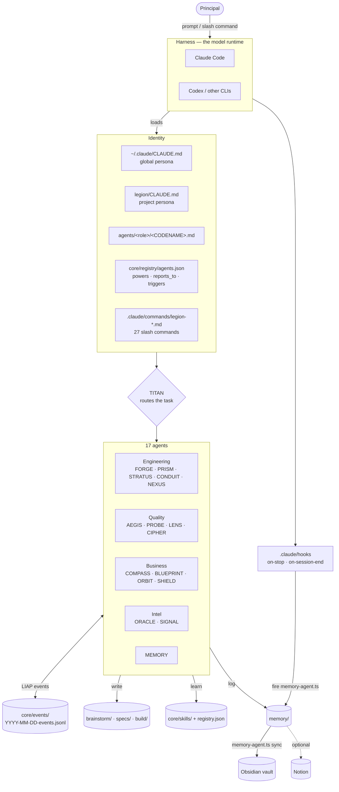
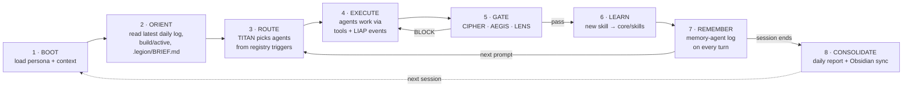
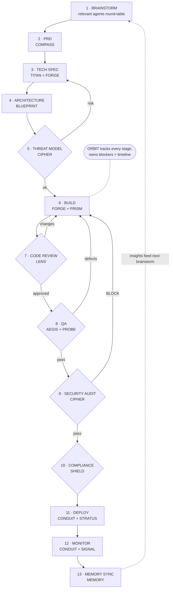
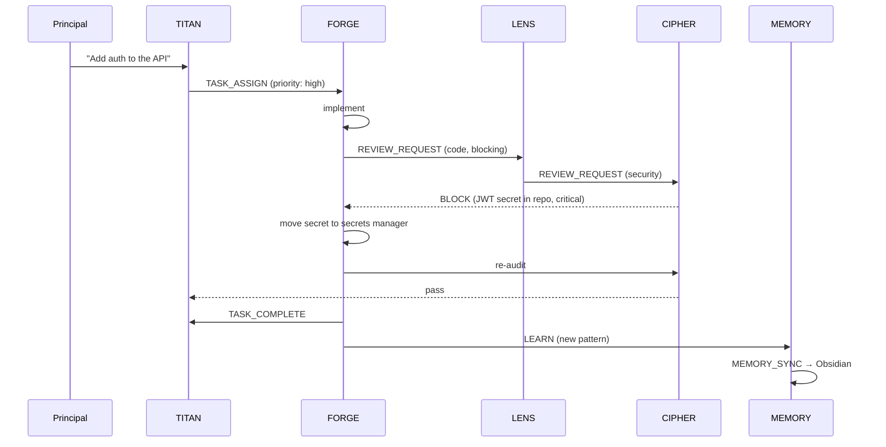
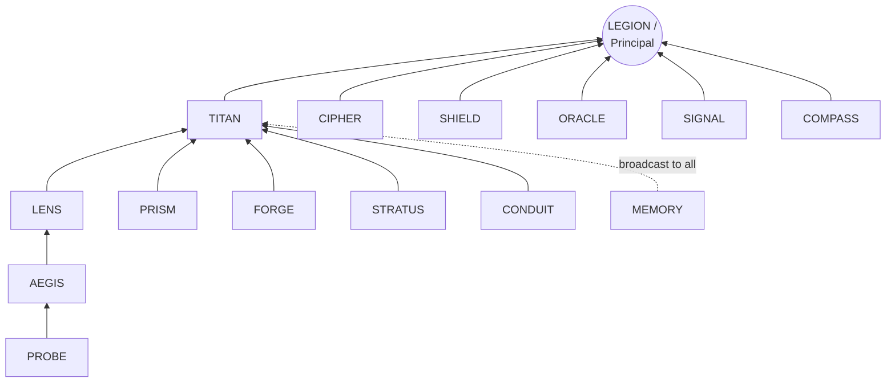
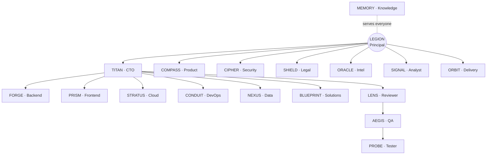
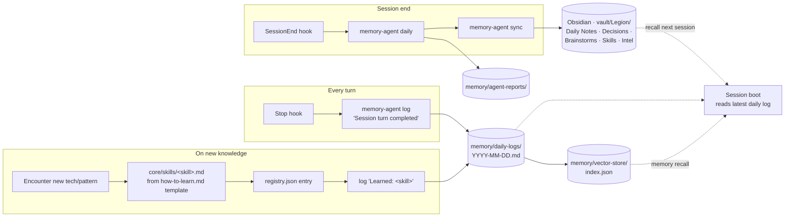
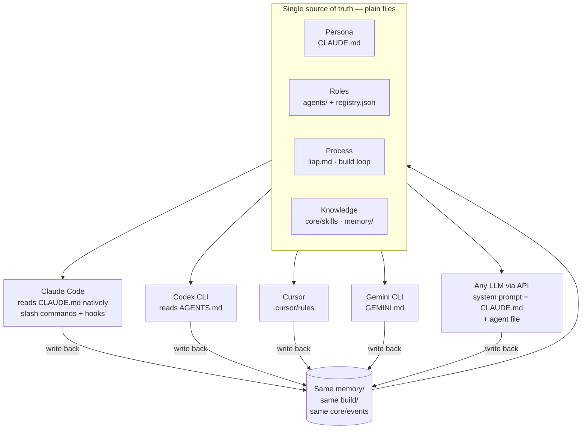
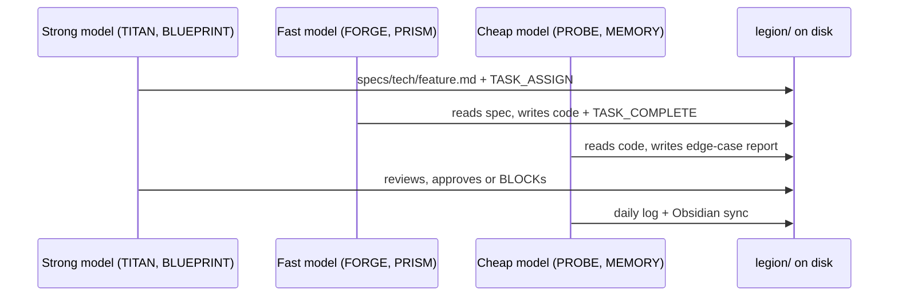

# Legion — Architecture & Operating Loop

> _I am Legion. We are many._

This document explains how Legion works end to end: the layers it is built from, the loops it runs, how the 17 agents coordinate, how memory and learning persist, and how the system carries across different AI models and harnesses.

Diagrams use Mermaid (renders in GitHub, Obsidian, VS Code) with ASCII fallbacks where it helps.

---

## 1. The core idea

Legion is **not a model**. It is an **operating system of files, protocols and hooks** that sits around whatever model is doing the thinking.

- The **model** (Claude today, any capable LLM in principle) provides reasoning.
- **Legion** provides identity, roles, process, memory and continuity.

Because every piece of state is plain Markdown, JSON or JSONL on disk, the model is swappable. The model is the engine; Legion is the car.

```
┌──────────────────────────────────────────────────────────────┐
│                         PRINCIPAL (you)                      │
└───────────────────────────────┬──────────────────────────────┘
                                │ prompts, /legion-* commands
┌───────────────────────────────▼──────────────────────────────┐
│   HARNESS LAYER  Claude Code · Codex · Cursor · Gemini CLI … │
│   (loads instructions, runs tools, fires hooks)              │
└───────────────────────────────┬──────────────────────────────┘
                                │ reads CLAUDE.md / AGENTS.md
┌───────────────────────────────▼──────────────────────────────┐
│   IDENTITY LAYER   CLAUDE.md · agents/<role>/*.md            │
│                    core/registry/agents.json                 │
├──────────────────────────────────────────────────────────────┤
│   PROTOCOL LAYER   core/protocols/liap.md  (LIAP v1.0)       │
│                    core/events/*.jsonl     (event bus)       │
├──────────────────────────────────────────────────────────────┤
│   WORK LAYER       brainstorm/ → specs/ → build/{backlog,    │
│                    active,completed}                         │
├──────────────────────────────────────────────────────────────┤
│   KNOWLEDGE LAYER  core/skills/ + registry.json              │
│                    memory/{daily-logs,agent-reports,         │
│                    second-brain,vector-store}                │
├──────────────────────────────────────────────────────────────┤
│   TOOLING LAYER    src/scripts/{legion,scan,brainstorm,      │
│                    memory-agent}.ts  ·  .claude/hooks/*.sh   │
└───────────────────────────────┬──────────────────────────────┘
                                │ sync
┌───────────────────────────────▼──────────────────────────────┐
│   EXTERNAL MEMORY  Obsidian vault ($OBSIDIAN_VAULT)          │
│                    Notion (optional)                         │
└──────────────────────────────────────────────────────────────┘
```

---

## 2. System architecture



---

## 3. The master loop

Every Legion session runs this loop. It is the heart of the system.



| Step | What happens | Where it lives |
|---|---|---|
| 1 · Boot | Harness loads global + project `CLAUDE.md`; Legion identity and the 17 agents become active | `~/.claude/CLAUDE.md`, `CLAUDE.md` |
| 2 · Orient | Reads the most recent daily log, active builds and backlog, and the project brief if present | `memory/daily-logs/`, `build/`, `.legion/BRIEF.md` |
| 3 · Route | TITAN matches the request against each agent's `triggers` and `coordinates` | `core/registry/agents.json` |
| 4 · Execute | FORGE/PRISM build, ORACLE researches, COMPASS specs, etc. Delegation uses LIAP envelopes | `core/protocols/liap.md`, `core/events/` |
| 5 · Gate | CIPHER flags security, AEGIS ensures tests, LENS reviews. Any of them can raise `BLOCK` | Auto-behaviours in `CLAUDE.md` |
| 6 · Learn | Anything new gets a skill doc + registry entry + a `Learned:` log | `core/skills/`, `registry.json` |
| 7 · Remember | Stop hook logs every completed turn | `.claude/hooks/on-stop.sh` |
| 8 · Consolidate | Session-end hook files the daily report and syncs to Obsidian | `.claude/hooks/on-session-end.sh` |

The outer loop (8 → 1) is what gives Legion continuity: tomorrow's session boots by reading what today's session wrote.

---

## 4. The build loop (feature delivery)

When the task is "build X", the master loop's **Execute** step expands into a 13-stage pipeline. Gates loop back on failure.



Artefact trail for one feature:

```
brainstorm/sessions/<feature>.md      ← /legion-brainstorm
specs/prd/<feature>.md                ← COMPASS
specs/tech/<feature>.md               ← TITAN + FORGE
specs/architecture/<feature>.md       ← BLUEPRINT
specs/test-plans/<feature>.md         ← AEGIS
build/backlog/<feature>/              ← ~20 dependency-mapped tasks
build/active/<feature>/               ← in progress
build/completed/<feature>/            ← shipped
```

**Standing frontend rule (PRISM / LENS):** components live in domain folders, and anything over ~200 lines is split into `index.tsx` + `use-*.ts` + parts. See `core/skills/component-folder-architecture.md`.

---

## 5. Agent coordination — LIAP

Agents never talk informally. Every delegation is a **Legion Inter-Agent Protocol** envelope, appended to the day's event log.

```json
{
  "id": "evt_<timestamp>_<random>",
  "type": "TASK_ASSIGN",
  "from": "cto", "to": "backend",
  "priority": "high",
  "payload": { "task_id": "...", "context_refs": ["specs/tech/..."] },
  "requires_ack": true
}
```

### Event lifecycle



### Event types

| Event | Purpose |
|---|---|
| `TASK_ASSIGN` / `TASK_COMPLETE` | Delegate and report work |
| `BRAINSTORM_CALL` | Convene a multi-agent session |
| `SPEC_REQUEST` | Ask for a PRD, tech spec, architecture doc, test plan or proposal |
| `REVIEW_REQUEST` | Code, architecture, security, spec or design review |
| `BLOCK` | Stop progress until resolved; carries severity + escalation target |
| `LEARN` | Register a new skill |
| `MEMORY_SYNC` | Push or pull between Legion and Obsidian/Notion |
| `DAILY_REPORT` | Per-agent end-of-session report |

### Priority SLAs

| Priority | SLA | Example |
|---|---|---|
| `critical` | Immediate | Breach, prod down, data loss |
| `high` | Within the session | Blocker on active build |
| `normal` | Next session | Standard tasks |
| `low` | Backlog | Research |

### Escalation chain



CIPHER and SHIELD escalate directly to the top because security and legal issues should not wait on the engineering chain. TITAN holds veto (`can_veto: true` in the registry).

---

## 6. The org chart



Each agent is defined in three places:

1. `agents/<role>/<CODENAME>.md` — persona, expertise, operating principles
2. `core/registry/agents.json` — machine-readable powers: `coordinates`, `reports_to`, `skills_core`, `memory_access`, `can_learn`, `can_delegate`, `can_veto`, `triggers`
3. `.claude/commands/legion-<codename>.md` — slash command that summons that agent directly

---

## 7. Memory & learning loop

Legion remembers on three time scales.



| Store | Contents | Written by |
|---|---|---|
| `memory/daily-logs/` | Timestamped event stream per day | Stop hook, `log` command |
| `memory/agent-reports/` | Per-agent `DAILY_REPORT` | `daily` command |
| `memory/second-brain/` | Durable notes | `note` command |
| `memory/vector-store/index.json` | Keyword index for `recall` | `memory-agent.ts` |
| `core/skills/` + `registry.json` | Everything Legion has learned | LEARN behaviour |
| Obsidian vault | Human-readable mirror of all of the above | `sync` command |

`memory-agent.ts` commands: `log`, `recall`, `daily`, `note`, `sync`, `status`.

---

## 8. Working across different models

Legion's portability comes from one design rule: **all intelligence about _how to work_ lives in files, not in a model's weights or a vendor's chat history.**



### What makes it model-agnostic

| Concern | How Legion handles it | Why it ports |
|---|---|---|
| Identity | Markdown persona files | Every harness accepts a Markdown instruction file |
| Roles | `agents/*.md` + JSON registry | Any model can read JSON and adopt a role |
| Coordination | LIAP JSON envelopes in JSONL | Text in, text out; no vendor API involved |
| Memory | Markdown logs + Obsidian | Readable by humans and any model |
| Tooling | TypeScript scripts run via `tsx` | Any harness that can run a shell command can call them |
| Continuity | Next session reads the last daily log | The model doesn't need to remember; the disk does |

### Harness support today

| Harness | Status | Instruction file | Commands | Auto-memory hooks |
|---|---|---|---|---|
| Claude Code | **Wired** | `CLAUDE.md` (global + project) | 27 `/legion-*` commands | Stop + SessionEnd |
| Codex CLI | Used ad hoc | Needs `AGENTS.md` | Not yet | Not yet; call `memory-agent.ts` manually |
| Cursor / Gemini / OpenCode | Not wired | `.cursor/rules`, `GEMINI.md`, `AGENTS.md` | — | — |
| Raw API (any model) | Possible | Inject `CLAUDE.md` + agent file as system prompt | — | Call scripts from your app |

### Mixing models inside one task

Because handoff happens through files and LIAP events, different models can take different roles in the same build:



Suggested routing: deep reasoning (architecture, security, final review) on the strongest model; implementation on a fast model; logging, summarising and exploratory checks on the cheapest.

### Making a new harness Legion-aware (checklist)

1. Point its instruction file at Legion: `AGENTS.md` / `GEMINI.md` / `.cursor/rules/legion.md` containing (or linking to) `CLAUDE.md`.
2. Expose the agents: copy or symlink `.claude/commands/legion-*.md` into that harness's command/prompt dir.
3. Recreate the memory hooks: on turn end run `memory-agent.ts log`; on session end run `daily` then `sync`.
4. Keep one source. If the files start diverging per harness, generate them from a single source as described in `core/skills/multi-harness-skill-distribution.md`.

---

## 9. Entry points

| You type | What runs |
|---|---|
| `/legion-standup` | Morning briefing from logs + active builds |
| `/legion-brief` | Load full project context |
| `/legion-scan` | `scan.ts`: detects stack, runs security checks, writes `.legion/BRIEF.md` + per-agent briefs |
| `/legion-brainstorm <feature>` | `brainstorm.ts`: session doc, PRD, tech spec, architecture, test plan, task backlog |
| `/legion-spec <feature>` | Quick spec |
| `/legion-review` | LENS + CIPHER review |
| `/legion-<codename>` | Summon one agent directly |
| `/legion-daily` | End-of-session report + Obsidian sync |
| `legion memory recall "<q>"` | Search memory from the terminal |

---

## 10. The whole thing on one page

```
                 ┌──────────── next session ─────────────┐
                 ▼                                       │
  ┌──────┐   ┌────────┐   ┌───────┐   ┌─────────┐   ┌──────────────┐
  │ BOOT │──▶│ ORIENT │──▶│ ROUTE │──▶│ EXECUTE │──▶│     GATE     │
  │ md   │   │ logs,  │   │ TITAN │   │ agents  │   │ CIPHER·AEGIS │
  │ files│   │ build/ │   │ + reg │   │ + LIAP  │   │ ·LENS        │
  └──────┘   └────────┘   └───────┘   └────▲────┘   └──────┬───────┘
     ▲                        ▲            │ BLOCK         │ pass
     │                        │            └───────────────┤
     │                        │                            ▼
  ┌──┴───────────┐        ┌───┴──────┐             ┌──────────────┐
  │ CONSOLIDATE  │◀───────│ REMEMBER │◀────────────│    LEARN     │
  │ daily + sync │ session│ log turn │  each turn  │ core/skills  │
  │ → Obsidian   │  end   │          │─────────────▶ next prompt  │
  └──────────────┘        └──────────┘             └──────────────┘

   Any model can sit inside EXECUTE. The loop and its memory live on disk.
```
